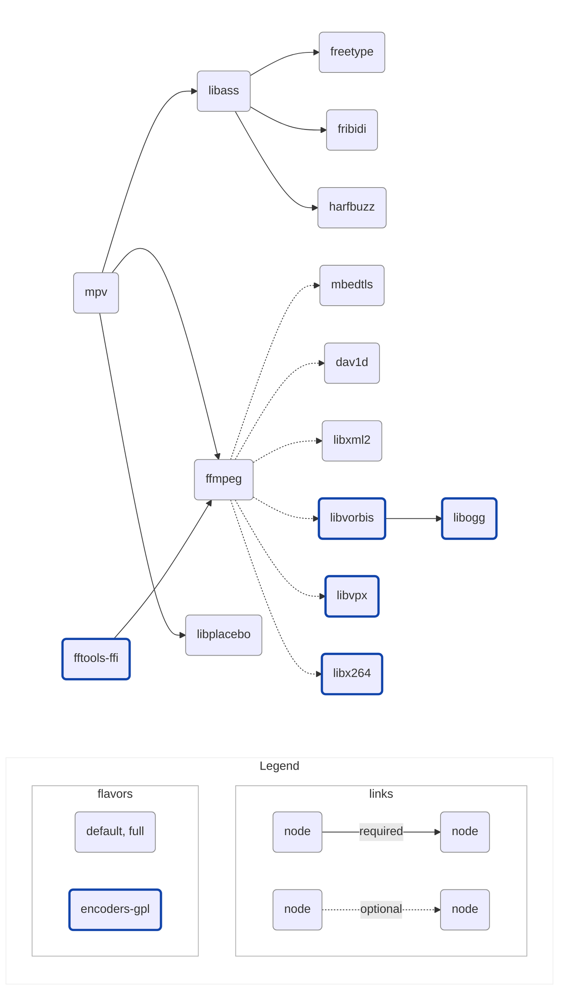

# libmpv android build

Provides builds of [libmpv](https://github.com/mpv-player/mpv) for Android,
used by [mediax](https://github.com/demoofbug/mediax), compatible with
commercial use for playback, and GPL use for encoding.

## Setup

- Linux (what CI uses) or macOS host
- JDK 17 (only needed for the Android SDK command-line tools)
- Everything else is installed by `buildscripts/download.sh`: host tools
  (autoconf, meson ≥ 1.3, ninja, …) plus the Android SDK command-line tools and
  NDK (≈ 1 GB download)

## Build

```shell
$ cd buildscripts
$ VERSION=v0.41.0+1 ./bundle_default.sh
$ tree artifacts
```

<details>
<summary>artifacts</summary>

```shell
.
├── default
│   ├── libmpv_v0.41.0+1_android-arm64-v8a-default.jar
│   ├── libmpv_v0.41.0+1_android-armeabi-v7a-default.jar
│   ├── libmpv_v0.41.0+1_android-x86-default.jar
│   ├── libmpv_v0.41.0+1_android-x86_64-default.jar
│   └── md5.txt
└── full
    ├── libmpv_v0.41.0+1_android-arm64-v8a-full.jar
    ├── libmpv_v0.41.0+1_android-armeabi-v7a-full.jar
    ├── libmpv_v0.41.0+1_android-x86-full.jar
    ├── libmpv_v0.41.0+1_android-x86_64-full.jar
    └── md5.txt
```

</details>

Each jar contains a single `lib/<abi>/libmpv.so` — FFmpeg and all other
dependencies are statically linked into it. Debug symbol archives
(`libmpv-symbols_<version>_<flavor>.zip`) are written next to `buildscripts/`.
Omitting `VERSION` stamps the artifacts with `+0`.

## Flavors

| Flavor         | Contents                          | Licence | Built |
| -------------- | --------------------------------- | ------- | :---: |
| **default**    | Curated playback decoder set      | LGPL    | ✅    |
| **full**       | All FFmpeg decoders/demuxers      | LGPL    | ✅    |
| **encoders-gpl** | full + encoding (`x264`, `libvpx`, `libvorbis`) via [fftools-ffi](https://github.com/moffatman/fftools-ffi) | GPL | ❌ |

Inclusion: `default ⊂ full ⊂ encoders-gpl`.

The **encoders-gpl** flavor is currently not built: fftools-ffi does not
compile against the FFmpeg 9 API (the same call was made in
[libmpv-darwin-build](https://github.com/demoofbug/libmpv-darwin-build)). The
flavor code and patches are kept for upstream alignment and can be re-enabled
in CI once fftools-ffi is ported.

## Naming convention

```
libmpv_<version>_android-<abi>-<flavor>.jar
libmpv-symbols_<version>_<flavor>.zip
```

| Component  | Notes                                            | Value                          |
| ---------- | ------------------------------------------------ | ------------------------------ |
| **version** | Engine version + build number ([Versioning](#versioning)) | `v0.41.0+1`, …        |
| **abi**    | Android ABI                                      | `arm64-v8a`, `armeabi-v7a`, `x86`, `x86_64` |
| **flavor** | Available decoders and encoders                 | `default`, `full`, `encoders-gpl` |

## Versioning

Releases are tagged as:

```
v<engine-version>+<build-number>
```

- **engine-version** is the exact upstream version of the primary engine built
  by this repository (currently mpv), copied verbatim — including any
  pre-release suffix it may carry (`-rc1`, `-beta`, …).
- **build-number** is a counter owned by this repository, starting at `1`,
  incremented on every rebuild of the same engine version.

`-` is never used as a separator, because upstream versions already use it for
pre-release suffixes. The two parts can therefore always be split unambiguously
at `+` (semver build metadata).

| Change                                           | Version transition            |
| ------------------------------------------------ | ----------------------------- |
| First build of mpv `0.41.0`                      | `v0.41.0+1`                   |
| Dependency / patch / build-config change         | `v0.41.0+1` → `v0.41.0+2`     |
| Engine upgrade (`0.41.0` → `0.42.0` or `0.41.1`) | `v0.42.0+1` / `v0.41.1+1`     |
| Engine pre-release (`0.42.0-rc1`)                | `v0.42.0-rc1+1`               |

Rules:

- The engine part is taken from `buildscripts/include/depinfo.sh` — the version
  actually built — so a mistyped tag cannot poison artifact names. The bundle
  scripts verify the tag's engine part against `depinfo.sh` and fail on
  mismatch.
- The build number comes from the tag's `+N` suffix; builds without a tag fall
  back to `+0` (CI passes the tag to the bundle scripts via the `VERSION`
  environment variable).
- Pushing a `v*` tag triggers CI, which builds the `default` and `full`
  flavors and publishes them to a GitHub Release named after the tag. Pushes
  to `main` do not trigger builds; pull requests and manual dispatch build
  without uploading anything.

## Version history

### Unreleased

- Upgraded **mpv** `78d4374` (master snapshot, `0.36`-era) → `0.41.0`
  (frozen on the release tag instead of a commit):
  - Added **libplacebo** `7.360.1` — a hard dependency of mpv since `0.37`
    (libmpv's GPU render pipeline, including the `render_gl` API, is built on
    it). The Vulkan backend is disabled; rendering goes through OpenGL ES.
  - Removed the `libplacebo` meson option from the mpv build (dropped
    upstream).
  - Ported `mpv_lavc_set_java_vm.patch` to `0.41.0` and regenerated
    `depend_on_fftools_ffi.patch` against its `meson.build`.
- Upgraded **FFmpeg** `6.0` → `9.0.1` (mpv `0.41.0` requires
  libavutil ≥ 58.29.100):
  - Removed `dash_base_url_escape.patch` and `hls_mp4_seek.patch` — both fixes
    are incorporated in the FFmpeg 9 source tree (verified line by line).
  - Removed `--disable-postproc` and the `libpostproc.so` install hook — the
    postproc library was removed upstream in FFmpeg 9.
  - Dropped `--enable-protocol=hls` — the HLS *protocol* was removed upstream
    in FFmpeg 9; HLS playback goes through the (still enabled) HLS demuxer.
- Upgraded **NDK** `25.2.9519653` → `29.0.14206865`; the minimum API level
  stays at **21** (unchanged from upstream).
- Removed everything related to **media-kit-android-helper** (clone, Gradle
  build, APK unpacking) — jars now contain only `libmpv.so` and no longer
  include `libmediakitandroidhelper.so`; the CI Gradle setup step is gone too.
- Removed the leftover Gradle/Maven publishing machinery (`gradlew`, wrapper,
  version catalog) — it published the upstream `com.alexmercerind.libmpv`
  artifact, but the Gradle module it built has been gone from this fork, and
  releases now ship as jars from GitHub Releases instead.
- Disabled the **encoders-gpl** flavor in CI — fftools-ffi does not compile
  against the FFmpeg 9 API.
- Introduced the `v<engine-version>+<build-number>` versioning scheme and
  tag-driven releases (this README).

## Minimum versions

| Platform | ABI                            | Min API |
| -------- | ------------------------------ | ------- |
| Android  | `arm64-v8a`, `armeabi-v7a`, `x86`, `x86_64` | `21` |

64-bit libraries are linked with a 16 KB page size, as required for
ARM64 devices with 16 KB kernels.

## Dependencies



- [**mpv**](https://github.com/mpv-player/mpv): A free (as in freedom) media
  player for the command line. It supports a wide variety of media file
  formats, audio and video codecs, and subtitle types

- [**ffmpeg**](https://ffmpeg.org): A cross-platform solution for converting,
  streaming, and recording audio and video, with support for a wide range of
  codecs and formats

- [**fftools-ffi**](https://github.com/moffatman/fftools-ffi): FFmpeg's
  command-line interface exposed as a shared library for FFI usage (not built
  since the FFmpeg 9 upgrade — upstream does not compile against the FFmpeg 9
  API yet)

- [**libass**](https://github.com/libass/libass): A library for rendering
  subtitles in videos, with support for advanced text formatting and
  positioning features

- [**libplacebo**](https://github.com/haasn/libplacebo): A video rendering
  and processing library — shader management, color management, tone mapping
  and high-quality scaling. A hard dependency of mpv since `0.37`: libmpv's
  GPU render pipeline (including the `render_gl` API) is built on it

- [**fribidi**](https://github.com/fribidi/fribidi): A library for handling
  bidirectional text (such as Arabic or Hebrew) in Unicode strings, with
  support for complex shaping and layout

- [**freetype**](https://sourceforge.net/projects/freetype/): A library for
  rendering high-quality text in graphics applications, with support for a wide
  range of font formats and glyph rendering techniques

- [**harfbuzz**](https://github.com/harfbuzz/harfbuzz): A library for shaping
  and laying out text in multiple languages and scripts, with support for
  advanced typography features such as ligatures and kerning

- [**dav1d**](https://code.videolan.org/videolan/dav1d): A library for
  cross-platform AV1 decoding

- [**libogg**](https://github.com/xiph/ogg): Reference implementation of the
  Ogg media container

- [**libvorbis**](https://github.com/xiph/vorbis): Reference implementation of
  the Ogg Vorbis audio format

- [**libvpx**](https://gitlab.freedesktop.org/gstreamer/meson-ports/libvpx):
  Reference implementation of the VP8 and VP9 video formats

- [**libx264**](https://www.videolan.org/developers/x264.html): Free software
  library for encoding video streams into the H.264/MPEG-4 AVC compression
  format

- [**mbedtls**](https://github.com/Mbed-TLS/mbedtls): An open source,
  portable, easy to use, readable and flexible TLS library

- [**libxml2**](http://xmlsoft.org/): A library for processing XML data, used
  by FFmpeg to support the Dash protocol

## Commercial use

### Default, Full flavors

| Dependency | Licence                                                | Commercial use |
| ---------- | ------------------------------------------------------ | :------------: |
| mpv        | LGPL-2.1 (`-Dgpl=false`)                               |       ✅       |
| ffmpeg     | LGPL-3.0 (`--enable-version3`, `--enable-gpl` & `--enable-nonfree` omitted) |       ✅       |
| libass     | ISC                                                    |       ✅       |
| libplacebo | LGPL-2.1                                               |       ✅       |
| freetype   | FreeType                                               |       ✅       |
| harfbuzz   | MIT                                                    |       ✅       |
| fribidi    | LGPL-2.1                                               |       ✅       |
| mbedtls    | Apache 2.0                                             |       ✅       |
| libxml2    | MIT                                                    |       ✅       |
| dav1d      | BSD-2-clause                                           |       ✅       |

### Encoders-GPL flavor

> Currently **not built** — disabled in CI since the FFmpeg 9 upgrade
> (fftools-ffi does not compile against the FFmpeg 9 API). The table below
> describes the flavor as it will ship once re-enabled.

| Dependency  | Licence                              | Commercial use |
| ----------- | ------------------------------------ | :------------: |
| mpv         | LGPL-2.1 (`-Dgpl=false`)             |       ✅       |
| ffmpeg      | GPL-3.0 (`--enable-gpl` `--enable-version3`, `--enable-nonfree` omitted) |       ❌       |
| libass      | ISC                                  |       ✅       |
| libplacebo  | LGPL-2.1                             |       ✅       |
| freetype    | FreeType                             |       ✅       |
| harfbuzz    | MIT                                  |       ✅       |
| fribidi     | LGPL-2.1                             |       ✅       |
| mbedtls     | Apache 2.0                           |       ✅       |
| libxml2     | MIT                                  |       ✅       |
| dav1d       | BSD-2-clause                         |       ✅       |
| fftools-ffi | LGPL-2.1                             |       ✅       |
| libx264     | GPL-2.0+                             |       ❌       |
| libvpx      | BSD-3-clause                         |       ✅       |
| libvorbis   | BSD-3-clause                         |       ✅       |
| libogg      | BSD-3-clause                         |       ✅       |

## Notes

- We use `meson` as much as possible in order to simplify cross-compilation,
  at the cost of some heaviness regarding legacy packages.

## Credits

- Forked from [media-kit/libmpv-android-video-build](https://github.com/media-kit/libmpv-android-video-build)
- mpv `0.41.0` / FFmpeg `9` upgrade referenced [jarnedemeulemeester/libmpv-android](https://github.com/jarnedemeulemeester/libmpv-android) and [mpv-android](https://github.com/mpv-android/mpv-android)
